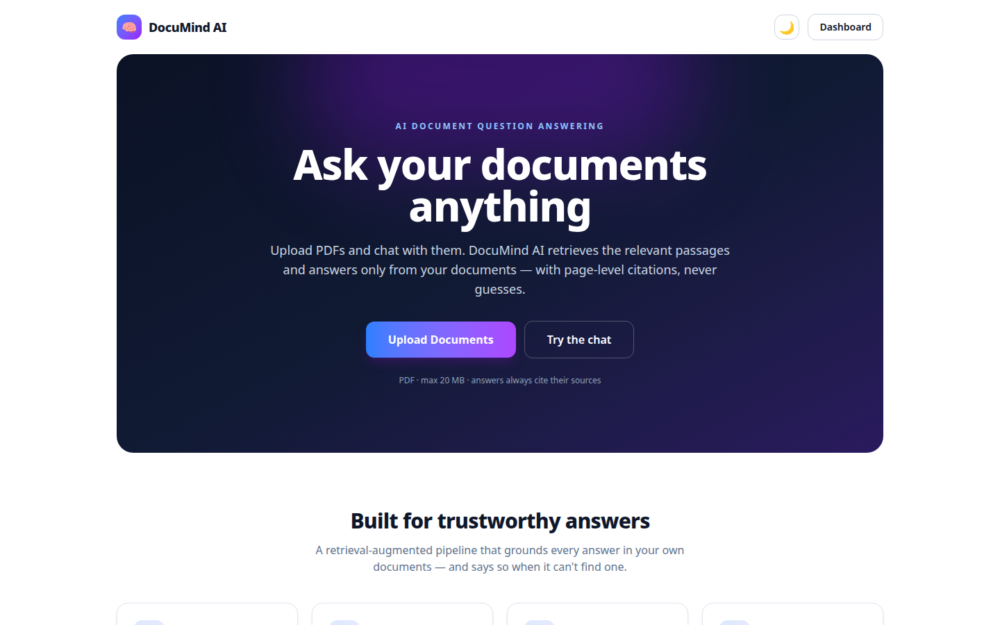
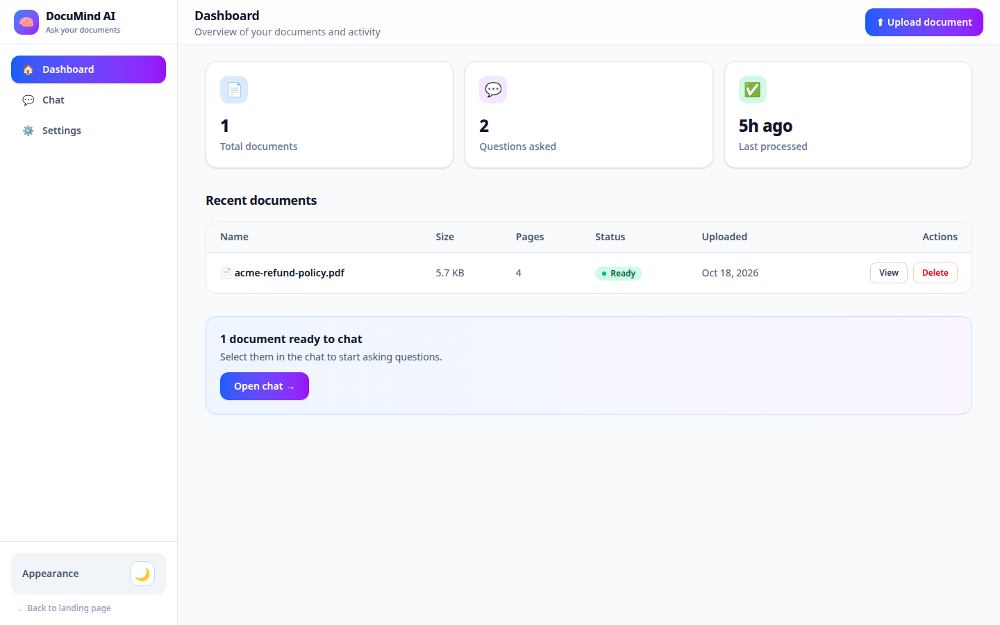
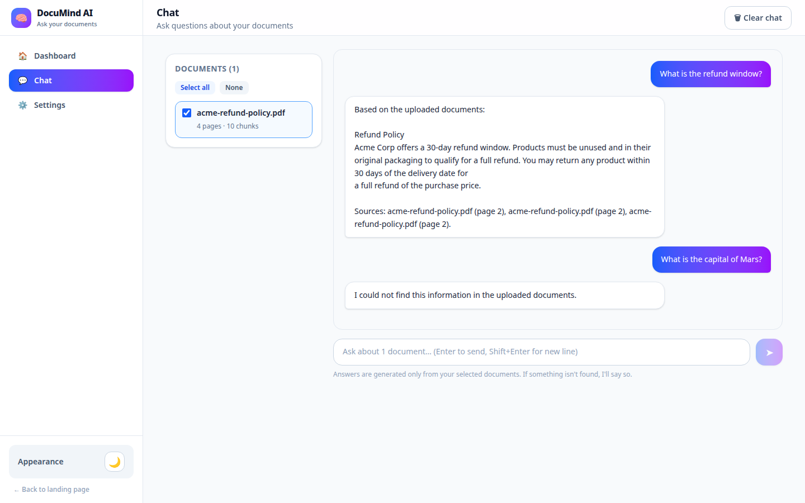

# DocuMind AI — AI-Powered Document Question Answering System


Upload PDFs, ask questions, and get answers grounded **only** in your documents —
with page-level source citations. If the answer isn't in the documents, the system
says so instead of guessing.




## Features

- **PDF upload** — drag-and-drop or file browse, with live progress and a visible
  processing pipeline (Uploading → Extracting → Chunking → Embedding → Indexing → Ready)
- **Strict RAG chat** — answers are generated only from retrieved document chunks;
  unknown questions get the exact response
  *"I could not find this information in the uploaded documents."*
- **Source citations** — every answer lists filename, page number, and a text preview
- **Document management** — list, inspect (pages/chunks/status), and delete documents
  (deletion cascades to chunks, vectors, and related chat messages)
- **Chat history** — persisted per session, clearable from the chat page or settings
- **Mock mode** — runs fully offline with deterministic local embeddings and an
  extractive mock LLM, clearly labeled as a local-testing baseline (no API key needed)
- **Real-model mode** — flip `MOCK_MODE=false` and point at any OpenAI-compatible
  embeddings + chat-completions API
- **Validation & safety** — PDF type (extension + magic bytes), 20 MB limit, SHA-256
  duplicate detection, password-protected / corrupt / empty / scanned-PDF handling,
  rate limiting, CORS, sanitized filenames, no stack traces or local paths in responses
- **Responsive UI** — light/dark theme, mobile layouts, toasts, skeletons, empty states




## Architecture

```
┌──────────────┐      ┌───────────────────────────────────────────────┐
│   React SPA  │─────▶│  FastAPI backend (/api)                       │
│  (Vite+TS)   │◀─────│  routes → services → SQLite + ChromaDB        │
└──────────────┘      └───────────────────────────────────────────────┘
```

**RAG pipeline** (`backend/app/services/`):

1. `pdf_service.py` — validates and extracts page-wise text with PyMuPDF
2. `chunking_service.py` — sentence-aware chunks (800 chars, 150 overlap, configurable)
   with `filename` + `page_number` metadata
3. `embedding_service.py` — OpenAI-compatible embeddings API, or deterministic
   hashed n-gram embeddings in mock mode
4. `vector_service.py` — ChromaDB persistent store behind a small `VectorStore`
   interface (swap in pgvector later without touching the RAG code)
5. `rag_service.py` — embeds the question, retrieves top-K chunks, applies the
   similarity threshold gate
6. `llm_service.py` — builds the strict system prompt and calls the chat API
   (or the extractive mock)

## Technology stack

| Layer    | Choice                                              |
|----------|-----------------------------------------------------|
| Frontend | React 19, TypeScript (strict), Vite 6, Tailwind CSS v4, react-router-dom 7 |
| Backend  | Python 3.12, FastAPI, Pydantic v2, SQLAlchemy 2.x    |
| PDF      | PyMuPDF                                             |
| Vectors  | ChromaDB (persistent local), numpy fallback         |
| Database | SQLite (local dev; Postgres-ready via `DATABASE_URL`)|
| AI       | Any OpenAI-compatible embeddings + chat API; mock mode for offline dev |
| Deploy   | Docker + docker-compose                             |

## Folder structure

```
documind-ai/
├── backend/
│   ├── app/
│   │   ├── main.py               # app factory: CORS, rate limits, error handlers
│   │   ├── config.py             # all settings from env vars
│   │   ├── database.py / models.py / schemas.py
│   │   ├── routes/               # documents.py, chat.py, health.py
│   │   ├── services/             # pdf, chunking, embedding, vector, rag, llm
│   │   ├── utils/security.py
│   │   └── middleware/rate_limit.py
│   ├── tests/                    # 38 pytest tests
│   ├── requirements.txt
│   └── Dockerfile
├── frontend/
│   ├── src/
│   │   ├── pages/                # Landing, Dashboard, Chat, DocumentDetails, Settings
│   │   ├── components/           # UploadModal, ChatMessage, SourceCard, Toast, …
│   │   ├── lib/api.ts            # typed API client (VITE_API_URL)
│   │   └── types/index.ts
│   ├── Dockerfile
│   └── package.json
├── scripts/make_sample_pdf.py    # generates the demo PDF
├── data/
│   ├── sample_docs/acme-refund-policy.pdf   # demo document (4 pages)
│   ├── uploads/ / vector_store/  # gitignored runtime data
├── screenshots/                  # UI screenshots
├── docker-compose.yml
├── .env.example
└── DEMO_SCRIPT.md                # 5-minute client demo walkthrough
```

## Environment variables

Copy `.env.example` to `.env` and adjust. Every variable has a working default;
only the API keys are needed for real-model mode.

| Variable | Default | Purpose |
|---|---|---|
| `DATABASE_URL` | `sqlite:///<root>/data/documind.db` | SQLAlchemy URL (Postgres-ready) |
| `VECTOR_STORE_DIR` / `UPLOAD_DIR` | `<root>/data/...` | ChromaDB / uploaded PDFs |
| `MAX_UPLOAD_MB` | `20` | Per-file upload limit |
| `CHUNK_SIZE` / `CHUNK_OVERLAP` | `800` / `150` | Chunking tuning |
| `TOP_K` | `5` | Retrieved chunks per question |
| `SIMILARITY_THRESHOLD` | `0.30` | Below this → "not found" answer |
| `MOCK_MODE` | `true` | `false` = use real embedding/LLM APIs |
| `EMBEDDING_API_URL` / `EMBEDDING_API_KEY` / `EMBEDDING_MODEL` | — | OpenAI-compatible embeddings |
| `LLM_API_URL` / `LLM_API_KEY` / `LLM_MODEL` | — | OpenAI-compatible chat completions |
| `HTTP_TIMEOUT_S` | `30` | API call timeout |
| `CORS_ORIGINS` | `http://localhost:5173` | Allowed browser origins |
| `APP_ENV` | `development` | `development` \| `production` |

Frontend: `frontend/.env` → `VITE_API_URL` (default `http://localhost:8000`).

## Local setup

Prerequisites: Python 3.11+, Node 18+.

### Backend setup

```bash
cd backend
python3 -m venv .venv && source .venv/bin/activate
pip install -r requirements.txt
cp ../.env.example ../.env   # optional — defaults work out of the box
uvicorn app.main:app --reload --port 8000
# API docs: http://localhost:8000/docs
```

### Frontend setup

```bash
cd frontend
npm install
cp .env.example .env         # optional — VITE_API_URL defaults to http://localhost:8000
npm run dev                  # → http://localhost:5173
```

### Docker setup

```bash
docker compose up --build
# frontend → http://localhost:5173, backend → http://localhost:8000
```

> Dockerfiles are provided for both services. `docker compose` was not
> run in this environment (no Docker daemon); the images follow standard
> `python:3.12-slim` / `node:24-alpine` patterns.

### Run in GitHub Codespaces (no local setup)

1. Open the repo on github.com → **Code** → **Codespaces** → **Create codespace on main**.
2. Wait for the devcontainer to finish (installs Python deps + npm packages automatically).
3. Terminal 1 — backend:
   ```bash
   cd backend
   CORS_ORIGINS=https://$CODESPACE_NAME-5173.app.github.dev uvicorn app.main:app --reload --port 8000
   ```
4. Terminal 2 — frontend:
   ```bash
   cd frontend
   VITE_API_URL=https://$CODESPACE_NAME-8000.app.github.dev npm run dev -- --host 0.0.0.0 --port 5173
   ```
5. Open the forwarded **5173** URL from the Ports tab — the app loads and talks to the backend.

## How to upload documents

1. Open the dashboard and click **Upload document** (or the landing-page CTA).
2. Drag a PDF into the dropzone or browse for it (PDF only, ≤ 20 MB).
3. Watch the pipeline steps: Uploading → Extracting → Chunking → Embedding →
   Indexing → Ready. The document appears in the table when ready.
4. Try the included demo file first: `data/sample_docs/acme-refund-policy.pdf`
   (generate it with `python scripts/make_sample_pdf.py` if missing).

Rejected files get a clear message: wrong type, too large, duplicate (by content
hash), password-protected, corrupt, empty, or scanned (needs OCR — detected, not
yet implemented).

## How the RAG pipeline works

1. Text is extracted **per page** and cleaned.
2. Pages are split into **sentence-aware overlapping chunks**; each chunk stores
   `document_id`, `filename`, `page_number`, `chunk_index`.
3. Chunks are embedded (real API or deterministic local mock) and stored in
   **ChromaDB** with metadata; chunk rows live in SQLite.
4. A question is embedded → **top-K cosine-similar chunks** are retrieved.
5. If the best similarity is **below `SIMILARITY_THRESHOLD`**, the API returns
   `"I could not find this information in the uploaded documents."` with no sources.
6. Otherwise the strict system prompt + retrieved context goes to the LLM, and the
   answer returns with **filename + page + text preview per source**.

The system prompt used verbatim:

> You answer questions only using the provided document context. Do not use
> outside knowledge. Do not guess. If the answer is not available in the context,
> say: "I could not find this information in the uploaded documents." Keep the
> answer clear and concise. Cite the source filename and page number when possible.

## API documentation

Interactive docs at `http://localhost:8000/docs` when the backend runs.

| Method | Endpoint | Description |
|---|---|---|
| POST | `/api/documents/upload` | Upload one PDF (multipart `file`) → `{id, status, page_count, …}` |
| GET | `/api/documents` | List → `{documents: […], total}` |
| GET | `/api/documents/{id}` | Details incl. `chunk_count`, `status` |
| DELETE | `/api/documents/{id}` | Cascade-delete file, chunks, vectors, messages |
| POST | `/api/chat` | `{question, document_ids[]}` → `{answer, sources: [{filename, page, text}]}` |
| GET | `/api/chat/history?limit=50` | `{messages: […], total}` (newest first) |
| DELETE | `/api/chat/history` | Clear history |
| GET | `/api/health` | `{status, mock_mode, documents, version}` |

Error responses are generic JSON (`{detail: "…"}`) — never tracebacks or paths.
Rate limits: 10 uploads/min, 30 chat requests/min per IP (HTTP 429 beyond).

## Testing

```bash
cd backend && source .venv/bin/activate
pytest -q            # 38 tests: health, validation, PDF, chunking, upload, chat, errors
```

```bash
cd frontend
npx tsc --noEmit     # strict typecheck
npm run build        # production build
```

The suite covers: health endpoint, PDF validation (type/size), text extraction,
chunk overlap + page metadata, upload happy path + duplicate (409) + invalid
(400/413), listing, details, chat validation (empty question 422, unknown doc 404),
the exact no-answer string for out-of-document questions, grounded answers with
page sources for in-document questions, delete cascades (vectors gone), and
friendly errors for unprocessed documents.

Manually verified end-to-end: upload → ready → known question answered with
page-2 citations → unknown question ("capital of Mars") → exact not-found message
→ history → delete. Screenshots in `screenshots/` were captured from this live run.

## Deployment instructions

- **Backend**: any host with Python 3.11+ (or the provided Dockerfile). Set
  `APP_ENV=production`, `MOCK_MODE=false`, real API keys, and a Postgres
  `DATABASE_URL`. Put it behind HTTPS (Caddy/Nginx/Cloudflare) and set
  `CORS_ORIGINS` to the frontend origin.
- **Frontend**: `npm run build` → serve `dist/` statically (or use the Dockerfile).
  Set `VITE_API_URL` at build time to the backend's public URL.
- **Docker**: `docker compose up --build -d` on a single VM; data persists in the
  `documind-data` volume.
- Never commit `.env` (it's gitignored). Rotate any key that was ever pasted
  into chat or committed.

## Known limitations

- Mock mode is a **local retrieval baseline**, not production quality — use real
  embeddings/LLM via `MOCK_MODE=false` for real deployments.
- Scanned/image PDFs are **detected** (`needs_ocr` status) but OCR is not implemented.
- Document processing is **synchronous** in the upload request (fine for ≤20 MB).
- **Single-user**: no authentication or multi-tenancy yet.
- Chat history is global, not per document set.

## Future improvements

- OCR pipeline (Tesseract / cloud OCR) for scanned PDFs
- Background processing queue (Celery/RQ) with websocket progress
- PostgreSQL + pgvector via the existing `VectorStore` interface
- User accounts, per-user document libraries, per-document chat threads
- Hybrid search (BM25 + vectors), reranking, answer confidence scores
- Export chat as PDF/markdown; shareable document links
